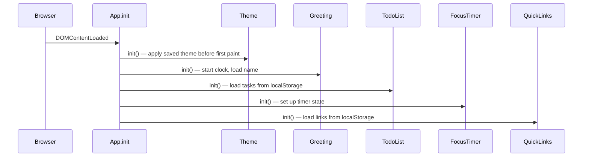

# Design Document

## Overview

The To-do List Life Dashboard is a single-page web application built with plain HTML, CSS, and vanilla JavaScript — no frameworks, no build tools, no server. It runs entirely in the browser and can be opened directly from the filesystem via `index.html`. All user data is persisted in the browser's `localStorage`.

The dashboard is composed of four independent widgets arranged on a single page:

1. **Greeting Widget** — live clock, date, and time-of-day greeting with a user-editable name
2. **To-Do List** — task management with add, edit, complete, and delete
3. **Focus Timer** — Pomodoro cycle with Work / Short Break / Long Break sessions
4. **Quick Links** — saved website shortcuts that open in a new tab

A global **Theme Toggle** switches between light and dark color schemes across all widgets.

### Design Goals

- **Beginner-readable**: each widget maps to a clearly named section of `js/app.js` and its own block of `css/style.css`. Every non-obvious step is commented in the code.
- **Zero dependencies**: the project ships as three files. Opening `index.html` in any modern browser is all that's needed.
- **Resilient**: every `localStorage` read is wrapped in a try/catch so a storage failure degrades gracefully rather than crashing the page.

---

## Architecture

The project follows a simple **module-per-feature** structure inside a single JavaScript file. Each feature is an immediately-invoked object literal (a plain object with `init()` + helper methods), wired together by a top-level `App.init()` call when the DOM is ready.

```
index.html          ← structure and widget markup
css/
  style.css         ← all styling, CSS custom properties for theming
js/
  app.js            ← all logic, one section per widget
```

There is no build step and no module bundler. The single `<script src="js/app.js">` tag at the bottom of `<body>` loads everything.

### Initialization Sequence



Theme is initialized first to avoid a flash of the wrong color scheme.

### Data Flow

All widgets are self-contained: they read from and write to `localStorage` directly. There is no shared in-memory store between widgets. The only cross-widget communication is the Theme toggle, which writes a class to `<body>` and persists the preference.

```
User Action
    │
    ▼
DOM Event Listener (in widget module)
    │
    ▼
Update in-memory state (widget-local variable)
    │
    ├──► Update DOM
    └──► Persist to localStorage
```

---

## Components and Interfaces

### 1. App (top-level coordinator)

```js
const App = {
  init() { /* called on DOMContentLoaded */ }
};
```

Calls `Theme.init()`, `Greeting.init()`, `TodoList.init()`, `FocusTimer.init()`, and `QuickLinks.init()` in that order.

---

### 2. Theme Module

Responsible for reading, applying, and persisting the light/dark preference.

```js
const Theme = {
  STORAGE_KEY: 'dashboard_theme',   // 'light' | 'dark'
  current: 'light',

  init(),        // reads localStorage → applies class to <body> → binds toggle button
  apply(theme),  // sets <body> class and updates toggle indicator
  toggle(),      // flips current ↔ saves ↔ applies
  _getSaved(),   // returns saved value or system preference or 'light'
};
```

The toggle button lives in the page header. Applying a theme adds either `theme-light` or `theme-dark` to `document.body`. All colors are CSS custom properties (`--color-bg`, `--color-text`, etc.) redefined per theme class.

---

### 3. Greeting Module

Handles the live clock, date display, and personalized greeting.

```js
const Greeting = {
  STORAGE_KEY: 'dashboard_username',
  NAME_MAX_LEN: 50,

  init(),              // starts clock interval, loads name, renders greeting
  _tick(),             // called every second; updates clock display; renders greeting on minute boundary
  _renderClock(),      // writes HH:MM to DOM; falls back to '--:--' on error
  _renderDate(),       // writes full date string to DOM; falls back to '-- --, ----'
  _renderGreeting(),   // picks morning/afternoon/evening and writes to DOM
  _getGreetingPhrase(hour),  // returns 'Good Morning' | 'Good Afternoon' | 'Good Evening'
  _loadName(),         // reads localStorage, returns stored name or 'Friend'
  _saveName(name),     // validates length, writes to localStorage, returns success bool
  _showNameError(msg), // displays inline error under name input
  _clearNameError(),
  _bindNameEdit(),     // wires up the edit-name button and input
};
```

The clock interval fires every second (not every minute) so the UI stays in sync across minute boundaries without drift. On each tick, `_renderClock()` and `_renderGreeting()` update only when the displayed minute changes.

---

### 4. TodoList Module

Manages the full lifecycle of tasks.

```js
const TodoList = {
  STORAGE_KEY: 'dashboard_todos',
  MAX_TASKS: 100,
  MAX_CHARS: 200,

  tasks: [],   // array of Task objects (see Data Models)

  init(),                    // loads tasks, renders list, binds add form
  _loadTasks(),              // reads + parses localStorage → this.tasks
  _saveTasks(),              // serialises this.tasks → localStorage
  _renderList(),             // rebuilds the task list DOM from scratch
  _renderTask(task, index),  // returns a <li> element for one task
  addTask(text),             // validates → pushes → saves → renders
  toggleComplete(id),        // flips done flag → saves → renders
  startEdit(id),             // replaces task <li> with inline edit input
  saveEdit(id, newText),     // validates → updates → saves → renders
  cancelEdit(id),            // re-renders without changes
  deleteTask(id),            // splices array → saves → renders
  _bindAddForm(),            // wires submit event on the add form
  _showAddError(msg),
  _clearAddError(),
  _updateAddButton(),        // disables "Add" when task count = MAX_TASKS
};
```

Tasks are stored as a JSON array. Each re-render calls `_renderList()` which rebuilds the entire `<ul>` — suitable for up to 100 items with no performance concern.

---

### 5. FocusTimer Module

Implements the full Pomodoro cycle state machine.

```js
const FocusTimer = {
  // Session durations in seconds
  DURATIONS: { work: 1500, short: 300, long: 900 },

  state: {
    phase: 'work',          // 'work' | 'short' | 'long'
    remaining: 1500,        // seconds left in current phase
    running: false,
    completedPomodoros: 0,  // 0-4 in current cycle
  },

  _intervalId: null,

  init(),              // renders initial display, binds buttons
  start(),             // starts setInterval(1000), updates button states
  stop(),              // clears interval, updates button states
  reset(),             // clears interval, restores full duration, updates display
  _tick(),             // decrements remaining; calls _onSessionEnd when 0
  _onSessionEnd(),     // plays beep, shows notification, advances phase, waits
  _advancePhase(),     // transitions work→short→long→work per cycle rules
  _updateDisplay(),    // writes phase label + MM:SS to DOM
  _updateButtons(),    // enables/disables Start, Stop, Reset
  _showNotification(msg), // renders on-screen alert; auto-dismisses after 10 s
  _dismissNotification(),
  _playBeep(),         // creates AudioContext oscillator beep; silent on error
  _formatTime(seconds), // returns 'MM:SS' string
};
```

The timer does **not** persist state to `localStorage` — refreshing the page resets the timer, which is acceptable for a single-session focus tool and keeps the implementation simple.

---

### 6. QuickLinks Module

Manages saved URL shortcuts.

```js
const QuickLinks = {
  STORAGE_KEY: 'dashboard_links',
  LABEL_MAX_LEN: 50,

  links: [],   // array of Link objects (see Data Models)

  init(),                  // loads links, renders panel, binds add form
  _loadLinks(),
  _saveLinks(),
  _renderLinks(),          // rebuilds the links panel DOM
  addLink(label, url),     // validates → pushes → saves → renders
  deleteLink(id),          // shows confirmation → removes → saves → renders
  _openLink(url),          // window.open(url, '_blank', 'noopener')
  _validateUrl(url),       // returns true if starts with http:// or https://
  _bindAddForm(),
  _showAddError(msg),
  _clearAddError(),
};
```

---

## Data Models

### Task

```js
{
  id: string,        // crypto.randomUUID() or Date.now().toString() fallback
  text: string,      // 1–200 characters (trimmed)
  done: boolean,     // true = completed
  createdAt: number  // Date.now() timestamp, used for stable ordering
}
```

### Link

```js
{
  id: string,        // crypto.randomUUID() or Date.now().toString() fallback
  label: string,     // 1–50 characters (trimmed)
  url: string        // must begin with 'http://' or 'https://'
}
```

### localStorage Schema

| Key | Type | Description |
|-----|------|-------------|
| `dashboard_theme` | `"light"` \| `"dark"` | Active color theme |
| `dashboard_username` | `string` (1–50 chars) | User's display name |
| `dashboard_todos` | JSON array of `Task` | All to-do items |
| `dashboard_links` | JSON array of `Link` | All quick links |

All reads use `JSON.parse` wrapped in `try/catch`. A parse error returns the safe default (empty array, `'Friend'`, `'light'`).

---

## Correctness Properties

*A property is a characteristic or behavior that should hold true across all valid executions of a system — essentially, a formal statement about what the system should do. Properties serve as the bridge between human-readable specifications and machine-verifiable correctness guarantees.*

### Property 1: Greeting phrase covers all hours

*For any* hour value in the range 0–23, `_getGreetingPhrase(hour)` SHALL return exactly one of "Good Morning", "Good Afternoon", or "Good Evening" — the full 24-hour range is partitioned with no gaps and no overlaps.

**Validates: Requirements 2.1, 2.2, 2.3**

---

### Property 2: Whitespace-only task names are rejected

*For any* string composed entirely of whitespace characters (spaces, tabs, newlines), `TodoList.addTask(text)` SHALL reject the input, leave `TodoList.tasks` unchanged, and not write to `localStorage`.

**Validates: Requirements 3.3**

---

### Property 3: Task add/remove round-trip persists correctly

*For any* valid (non-empty, ≤ 200-char) task text, after calling `TodoList.addTask(text)` and then reloading `TodoList._loadTasks()` from `localStorage`, the tasks array SHALL contain a task with the same text in the same position it was added.

**Validates: Requirements 3.4**

---

### Property 4: Task list never exceeds the maximum

*For any* sequence of `addTask` calls on a list that already contains the maximum number of tasks (100), the tasks array length SHALL remain at 100 and no new task SHALL be added or persisted.

**Validates: Requirements 3.5**

---

### Property 5: Edit preserves task identity

*For any* task in the list and any valid replacement text (1–200 non-whitespace chars), `TodoList.saveEdit(id, newText)` SHALL update only the `text` field of that task while leaving `id`, `done`, and `createdAt` unchanged.

**Validates: Requirements 4.3**

---

### Property 6: URL validation accepts only http/https

*For any* URL string, `QuickLinks._validateUrl(url)` SHALL return `true` if and only if the string begins with `"http://"` or `"https://"`.

**Validates: Requirements 7.2, 7.7**

---

### Property 7: Quick-link add/remove round-trip persists correctly

*For any* valid label (1–50 chars) and valid URL, after calling `QuickLinks.addLink(label, url)` and reloading `QuickLinks._loadLinks()` from `localStorage`, the links array SHALL contain a link with the same label and URL.

**Validates: Requirements 7.4, 7.5**

---

### Property 8: Pomodoro phase sequence is deterministic

*For any* starting state with `completedPomodoros` in the range 0–3, calling `_advancePhase()` from a `'work'` phase SHALL transition to `'short'` and increment `completedPomodoros`; when `completedPomodoros` reaches 4, calling `_advancePhase()` SHALL transition to `'long'` and, when that long break ends, reset `completedPomodoros` to 0 and return to `'work'`.

**Validates: Requirements 5.1, 5.2, 5.3, 5.4**

---

### Property 9: Timer format is always MM:SS

*For any* integer `seconds` in the range 0–5999 (the maximum session duration), `FocusTimer._formatTime(seconds)` SHALL return a string matching the pattern `MM:SS` where MM is zero-padded minutes and SS is zero-padded seconds, and `MM:SS` decoded back to seconds SHALL equal the original input.

**Validates: Requirements 5.5**

---

### Property 10: Theme toggle is idempotent-free and invertible

*For any* current theme `t ∈ { 'light', 'dark' }`, calling `Theme.toggle()` twice SHALL return the theme to `t` (i.e., toggle is its own inverse). Additionally, after any number of toggles, the class applied to `<body>` SHALL always match `Theme.current`.

**Validates: Requirements 9.1, 9.2, 9.3**

---

## Error Handling

| Scenario | Behavior |
|----------|----------|
| `localStorage` read fails (SecurityError, QuotaExceededError, parse error) | Return safe default; log warning to console; do not display an error to the user |
| `localStorage` write fails | Show a brief inline error message near the affected widget; retain in-memory state so the page stays functional |
| `AudioContext` unavailable or blocked | Silently skip beep; on-screen notification still fires |
| `crypto.randomUUID()` unavailable (old Safari) | Fall back to `Date.now().toString() + Math.random()` for ID generation |
| Timer `setInterval` drift | Re-compute remaining time from wall-clock delta on each tick to prevent accumulated drift over long sessions |
| Quick link deletion `localStorage` failure | Retain the link button in the UI; show error "Deletion failed. Please try again." (Requirement 8.3) |
| Name > 50 characters | Do not save; display inline error "Name must be 50 characters or fewer." |

---

## Testing Strategy

### Unit Tests

Unit tests verify specific behaviors and edge cases for pure functions. Each widget section in `app.js` exports (or exposes via a test hook) its key helper functions.

| Function | Test focus |
|----------|-----------|
| `Greeting._getGreetingPhrase(hour)` | Boundary hours: 0, 4, 5, 11, 12, 17, 18, 23 |
| `Greeting._saveName(name)` | Empty, exactly 50 chars, 51 chars |
| `TodoList.addTask(text)` | Empty string, whitespace-only, exactly 200 chars, 201 chars, at 100-task limit |
| `TodoList.saveEdit(id, text)` | Whitespace-only update is discarded, valid update persists |
| `FocusTimer._formatTime(s)` | 0 → "00:00", 59 → "00:59", 1500 → "25:00", 899 → "14:59" |
| `FocusTimer._advancePhase()` | Full 4-pomodoro cycle: work→short (×3) →work→long→work, counter resets |
| `QuickLinks._validateUrl(url)` | Various valid and invalid URL formats |
| `QuickLinks.addLink(label, url)` | Empty label, empty URL, invalid scheme, valid entry |

### Property-Based Tests

The project targets a browser environment with vanilla JS. Property-based tests are written using [fast-check](https://fast-check.dev/), which runs in Node.js via a simple test script (`npm test` calls Node directly without a bundler, using CommonJS-compatible requires of the pure helper functions extracted from `app.js`).

Each property test runs a minimum of **100 iterations**.

| Property | Generator inputs | Assertion |
|----------|-----------------|-----------|
| **Property 1** — Greeting phrase covers all hours | `fc.integer({ min: 0, max: 23 })` | Result is one of the three valid phrases; mapped correctly per range |
| **Property 2** — Whitespace-only tasks rejected | `fc.string().filter(s => s.trim() === '')` | `addTask` returns false; task array length unchanged |
| **Property 3** — Task round-trip | `fc.string({ minLength: 1, maxLength: 200 }).filter(s => s.trim().length > 0)` | After add + reload, task text matches |
| **Property 4** — Max task count | `fc.array(fc.string({ minLength: 1 }), { maxLength: 150 })` | Array never exceeds 100 after all adds |
| **Property 5** — Edit preserves identity | Task object + `fc.string({ minLength: 1, maxLength: 200 })` | `id`, `done`, `createdAt` unchanged after saveEdit |
| **Property 6** — URL validation | `fc.string()` | `_validateUrl` result matches manual prefix check |
| **Property 7** — Link round-trip | Valid label + URL arbitraries | After add + reload, label and URL match |
| **Property 8** — Pomodoro sequence | `fc.nat({ max: 3 })` as starting `completedPomodoros` | Full cycle always terminates at `completedPomodoros = 0`, `phase = 'work'` |
| **Property 9** — Timer format round-trip | `fc.integer({ min: 0, max: 5999 })` | `_formatTime` output parsed back equals input seconds |
| **Property 10** — Theme toggle invertible | `fc.constantFrom('light', 'dark')` as starting theme | Two toggles return to starting theme; `<body>` class always matches `Theme.current` |

Tag format for each test: `// Feature: todo-list-life-dashboard, Property {N}: {property_text}`

### Integration / Smoke Tests

Manual checklist (no automated tooling required for the beginner scope):

- Open `index.html` in Chrome, Firefox, Edge, Safari — all widgets render without console errors
- Reload the page — name, tasks, links, and theme are all restored correctly
- Open DevTools → Application → Local Storage — verify all four keys are present and well-formed JSON
- Test with DevTools set to block `localStorage` — page loads with defaults, no crash
- Test audio notification — session-end beep fires in Chrome/Firefox; no error in Safari
